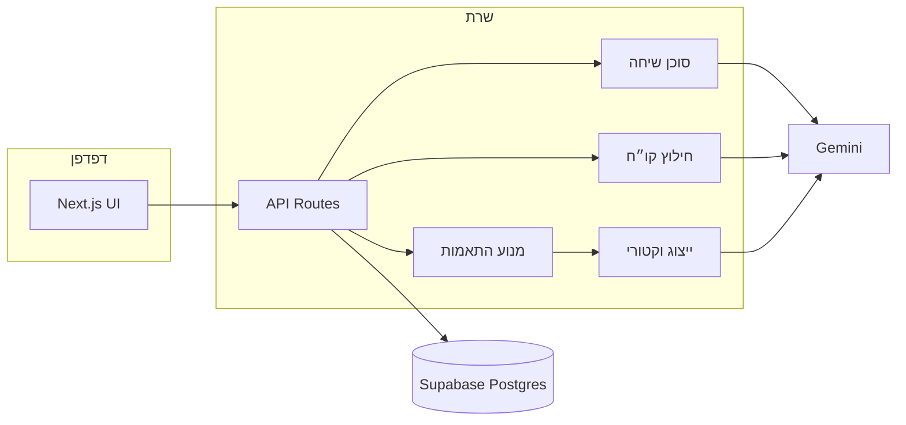

# CITOV — השמה חכמה דרך שיחה

**English summary below.**

CITOV מחבר מועמדים למעסיקים בלי חיפוש: סוכן שיחה ממלא **כרטיס מועמד** / **כרטיס משרה**, **מנוע התאמות** מדרג זוגות, ומעסיקים מאשרים — המועמד רואה רק מה שאושר.

## ארכיטקטורה (תמצית)



פירוט מלא: [docs/architecture.html](docs/architecture.html) · בפרודקשן: **פורטל מנהלים → ארכיטקטורה**.

## מנוע התאמות

1. ציון קלאסי (כללים + שדות)  
2. ייצוג וקטורי לפי מקטעים (תפקיד / כישורים / פרופיל)  
3. שילוב היברידי + רצפת דמיון + שער דרישות חובה  
4. **סף** לכניסה ל**תור** — ניתן ל**כיול** מתיוג מנהל  

מדדים: `npm run eval:matching` · סף רגרסיה: `npm run ci:prompt-regression`.

## בטיחות AI

- זהות CV ≠ בעל חשבון ללא אישור  
- חילוץ עם **ראיות** (golden eval)  
- הרשאות per-user ב-API  
- Gemini נופל → מצב מוגבל + שחזור Cron  

## הרצה מקומית

```bash
cp .env.example .env.local
npm ci
npm run dev
```

`DATABASE_URL` — Postgres (Supabase). `GOOGLE_GENERATIVE_AI_API_KEY` — שיחה וחילוץ.

## סקריפטים

| פקודה | תיאור |
|--------|--------|
| `npm run dev` | שרת פיתוח |
| `npm test` | בדיקות יחידה |
| `npm run lint` / `typecheck` | איכות קוד |
| `npm run seed:test-sandbox` | מערך בדיקה 150×150 (DB) |
| `npm run eval:matching` | הערכת התאמה |

## English

**CITOV** is a conversation-first hiring POC: AI agents fill structured candidate/job cards, a **hybrid matcher** (rules + embeddings) ranks pairs, employers approve, candidates only see approved opportunities. Stack: **Next.js**, **Supabase Postgres** (+ pgvector), **Gemini**. Admin portal includes architecture docs, labeling sandbox, monitoring, and run reports. See `docs/SSOT/GO_LIVE.md` for production checklist.
